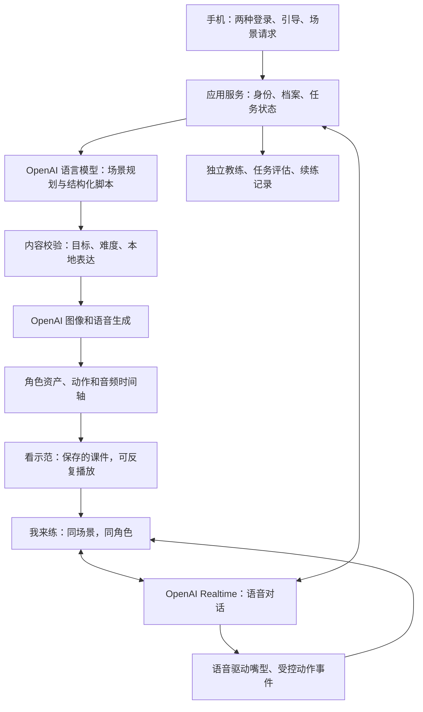

# Learning English in Singapore · 产品规格

版本：v0.1 · 方向评审稿｜资料核查：2026-09-10｜文档性质：Loopwork 四份核心文档中的第一份 `spec.md`

**产品目标：让来到新加坡的人，能在自己真正要面对的生活和工作场景中听懂、开口、接住变化，逐步融入本地生活。**

本文把用户已明确的诉求、两份痛点报告、技术事实和建议方案分别标明。功能与验收条件是待确认的产品规格；没有把文档评审当成产品实测，也没有开始开发。后续 `rules.md / plan.md / tasks.md` 不在本次交付范围。

## 0. 需要先看清的结论

核心体验有可组合的技术基础：按需生成场景、双角色示范、反复听、让用户接替角色、动态追问、提示与纠错。当前不能直接承诺它已经是一套经过验证的零基础新加坡英语产品。

**唯一直接冲突的供应商要求：OpenAI 官方宣布 Sora 2 和 Videos API 于 2026-09-24 关闭，距核查日 14 天，并未在该公告列出推荐替代。不能把 OpenAI 视频生成 API 作为新产品长期基础。** [T01](https://developers.openai.com/api/docs/deprecations)

建议保留全部学习体验，用 OpenAI 语言模型规划内容、图像模型生成背景与物件、语音模型提供示范和实时对话，再由可编程卡通角色完成嘴型、指向、点头等动作。这是**需要用户确认的技术路线调整 D01**，不是已批准的替换。若必须使用生成式视频模型，可另评 Runway；若需要视频数字人，可另评 Tavus。两者都要重新测试教学控制、延迟和声音一致性。[T36](https://docs.tavus.io/sections/conversational-video-interface/echo-mode) [T37](https://docs.dev.runwayml.com/api-details/sdks/)

**已确认的上线边界：第一版服务已在新加坡等支持地区的用户，保留微信和 Google 登录。** 微信账户类型、母语、国籍与实际服务地区分开处理；第一版不承担中国大陆直接使用学习功能的需求。支持地区上线前按官方现行名单复核。[T11](https://developers.openai.com/api/docs/supported-countries)

产品是否成立，取决于四个尚需实测的条件：零基础能否独立开始、声音是否真的像新加坡本地输入、真实手机对话是否顺畅、用户能否应对没有背过的新问法。不能用模型名或仓库活跃度替代这些验收。

## 1. 文档依据与证据边界

### 1.1 三类输入

| 输入 | 本文如何使用 | 不能推出什么 |
| --- | --- | --- |
| R1：第一份综合英语痛点报告，151 条来源台账 | 确定新加坡生活、工作、学校和本地语音的真实需求；保留华语及其他母语视角 | 来源条数不是独立受访者数，不能推算人群比例 |
| R2：第二份学习痛点报告，72 条证据记录 | 使用 L1-L10 痛点编码，转成产品行为与验证任务 | 不把帖子、自荐、评论和研究样本相加；不声称 AI 普遍优于真人 |
| U：用户本次完整设想和个人经历 | 视为明确需求与一位创始用户的经历；优先满足听说、私人练习和可定制场景 | 不把个人经验当普遍学习规律；不推定竞品商业动机 |

R1 文件：`research/2026-09-10-v2/REPORT.md`；R2 文件：`research/2026-09-10-learning/REPORT.md`。本次技术来源登记于 `research/2026-09-10-product/sources.json`，原始检索与读取结果在其 `raw/` 目录。两份原报告保持原样。

用户个人经历 U002：使用过 Duolingo、摩打、VOA Learning English 和一个未具名的澳大利亚 Learning English 网站；认为 VOA 的场景和反复听有效，但无法选择自己需要的新加坡场景。未补猜未具名网站，也未把这些产品全部判为没有动态 AI 功能。

### 1.2 本轮技术研究方法

沿“场景生成、实时语音、教学反馈、角色动画、登录、本地语音”检索；从 V2EX、LINUX DO、Hacker News 和 OpenAI Developer Community 的作者帖子追溯 GitHub，再用供应商官方文档校验能力、限制和停用日期。掘金等搜索结果只作线索，不把转载当独立技术验证。

纳入 39 条技术与工作流来源：20 条官方资料、11 个技术仓库、7 个论坛主题、1 项工作流来源。7 个论坛主题分布为 V2EX 3、LINUX DO 1、Hacker News 1、OpenAI Developer Community 2。不同帖子涉及同一项目时保留关联，不计为多个独立产品。检索是围绕技术决策的目的性取样，不是穷尽市场调查。

本次核查了文档、README、仓库元数据和关键许可；**没有运行这些项目、购买服务、调用付费模型、测量延迟或验证学习效果**。论坛里的性能是作者自述，历史故障用于设计测试，不视为当前通用缺陷。部分官方材料只有检索摘录，访问程度逐条登记。

### 1.3 必须保留的研究修正

华人族群、中文母语、中国国籍、游客、新移民、永久居民不是同一个统计口径。本文不采用“70% 中国用户 / 30% 其他用户”加权，不据此推导移民批准比例。通过明确招募和测试华语零基础者提高其产品关注度，同时保留非华语零基础组。

“只听说”是本产品的聚焦，不代表所有新来者都不需要读写。R1 中也有学术、文书等需求；这部分明确留在首版目标之外。真人课程对部分用户有效；本产品为不愿、不能或暂时不准备参加这类课程的人提供完整替代练习入口。

## 2. 定位、用户与成功定义

### 2.1 产品定位

**面向在新加坡生活的成人新来者，以个人真实任务为起点的私人 AI 听说排练工具。**

一次学习围绕一个能说明白的任务，例如“明天和老师见面，我想知道孩子是否听懂课堂要求，以及我在家可以怎么帮忙”。用户先看到对话怎样发生，再在相同场景中自己说，最后练没有见过的变化。

“属于新加坡”体现为本地场景、本地可理解的语音、用语和礼貌尺度，而非仅增加国旗、地标或 `lah`。目标是沟通可理解与参与生活，不要求用户消除自己的母语口音。

### 2.2 优先用户状态

| 用户状态 | 典型任务 | 首版必须解决的障碍 |
| --- | --- | --- |
| 近零基础成人，含陪读照料者、团聚家属、工作者 | 学校见面、点餐、工作确认 | 读不懂英文引导、不知第一句怎么说、需要母语救援 |
| 读过英语但听说调用困难的人 | 解释工作事项、接待、电话约时间 | 字看得懂，声音来不及理解；固定台词之外卡住 |
| 愿意私下练习、对评价敏感的人 | 向陌生人请求帮助、回应追问 | 进入练习前紧张、停顿被打断、纠错造成挫败 |
| 已有英语基础但不熟悉新加坡的人 | 同事闲聊、服务交流、本地表达 | 熟悉的美英材料与实际语音、语用不匹配 |

这些状态可重叠。英文起点、开口意愿、可用时间、母语分别收集，不用民族、年龄、教育程度或“I 人”标签自动判级。首版以成人为使用者；家长会内容不等于为儿童开设账号。

### 2.3 成功的定义

一次场景练习成功：用户能理解任务所需的核心意思，表达自己的真实意图，并在对方换问法或出现一个小变化时继续沟通。需要帮助时，能使用请求重复、放慢、确认等修复表达。

业务主指标建议为“每周完成一次未见过的同类场景任务的活跃学习者数”。必须同时报告完成标准、提示用量、起点分组与失败样本。听了多少遍、连续登录多少天、说了多少分钟是过程指标，不能代替能力结果。

## 3. 痛点怎样进入产品

| 证据主题 | 已观察到的问题 | 对应设计 | 验证方式 |
| --- | --- | --- | --- |
| R1 X036、X019；R2 L1 | 基础很低，开始学本身有门槛 | F2 音频/图片问答；F5 母语救援；F7 有支撑的开口 | 零基础不读英文也能完成首轮 |
| R2 L2、L6 | 怕评价、答不出、被抢话或不懂纠错 | F7 自主开麦；F8 等待、提示、可选纠错时机 | 观察停顿、退出和再次尝试 |
| R1 C004；R2 L3、L7 | 家庭与工作时间零散，恢复练习困难 | F6 分段重复；F11 随时暂停和续练 | 中断后返回同一位置、同一角色 |
| R2 L4、L5 | 练过的内容无法满足真实任务或意图 | F3 自定目标；F9 保留意图的变化练习 | 合理的非台词回答被接住 |
| R2 L8 | 完成课程不等于现实进步 | F10 未见问法与支持程度记录 | 与示范分离的任务评估 |
| R1 E009、E017、E021；R2 L10 | 本地口音与表达听不懂 | F4 分层本地化；F12 本地编辑与语音验收 | 新加坡听者审查；换声音仍能听懂 |
| R2 L9 | 试错和收费边界增加负担 | F14 使用和错误状态清楚；后续收费另定 | 失败重试不重复建课、不隐藏扣费逻辑 |

R2 的 L7、L8 仍缺纵向观察，L9 没有本地负担量化；本文把对应方案写成待检验假设，不伪装成已证实的解决方法。

## 4. 首版完整学习路径

进入网站，在登录页确认熟悉的辅助语言 → 选择微信或 Google → 3-5 分钟以内的可跳过引导与听力选择题 → 确认当前学习起点 → 说出最近要做的事 → 看并确认场景目标 → 生成双角色示范 → 按句、片段或整段重复 → 接替其中一个角色开口 → 练一次变化 → 看听说任务结果 → 保存，下次继续。

辅助语言选择无需登录，也不是第三个账号入口。浏览器语言只能作为建议；用户可在登录页直接更换并听操作说明。选择通过短时匿名状态保留到授权返回、失败重试和外部浏览器接续，登录后再关联本人偏好。

主学习页只保留“看示范”和“我来练”两个模式。提示、逐步减少支撑、变化练习都发生在“我来练”内，不把初学者送入多个陌生菜单。选择题、词汇释义、操作提示可以用母语；角色的主体交流使用英语。

## 5. 功能与可手工验收的标准

P0 表示完整首版不可缺；P1 为首版后增强；P2 为更后期。下面的验收是设计要求，尚未执行。每个 F 功能最多五条用户可感知的验收，技术验收另见第 13-16 节。

### F1 · 两个登录入口与地区边界（P0）

1. 登录页只有微信和 Google 两种账号入口；两者都可选择，不依据国籍隐藏其中之一；未登录也能选择辅助语言和听说明，产品不另要求设置密码、验证邮箱或填写手机号。
2. 第三方授权成功后直接进入首次引导；用户取消授权可重试，不产生空账号；已有用户回到自己的学习记录。
3. 在微信内遇到不支持的 Google 登录环境时，看见辅助语言的系统浏览器打开指引；不会反复陷入同一错误页。[T34](https://developers.google.com/identity/siwg/best-practices)
4. 微信身份用户在目标手机上有可实际完成的路径；只有电脑二维码、要求用同一部手机扫描自己屏幕，不能算移动登录验收通过。具体路径通过 G1 后才承诺。
5. 不支持地区得到明确服务提示；不通过更换登录身份或代理指南规避服务范围。跨登录方式合并账号必须验证两个身份，不能因相同昵称或邮箱自行合并。

### F2 · 几分钟认识用户，而非先考试（P0）

1. 用户先选辅助语言，可以听操作说明；选择“几乎不会英语”后，不需要读英文或输入英文即可继续。
2. 问答主要为选择题：学习目的、场景、可出声时间、希望得到多少帮助，以及短音频配图理解题；问完就显示下一步，不一次铺满表单。
3. 用户可选“不知道”、跳过或稍后继续；系统显示“暂按入门程度开始，可随时调整”，不把未测内容记成零分。
4. 初次结果分开呈现“目前能听懂的内容”“说英语尚未了解”“建议的支撑和速度”；不声称仅凭选择题判定完整口语或正式 CEFR 水平。
5. 第一轮练习允许选择更简单、更慢或更少提示；系统依据后续真实表现修正档案，用户能看到并改回，不暗中持续降级。

### F3 · 用户决定自己要练的事（P0）

1. 用户可以选择家长会、工作、生活服务等起点，也可以用熟悉的语言语音或文字描述一个新任务；不要求先会英文提示词。
2. 系统把“和谁、在哪里、希望办成什么、最担心哪一步”复述成可点选确认的场景卡；不清楚时只追问一个必要细节。
3. 用户修改目的后，示范和后续练习都按新目的进行；不是仅替换课件标题或人名。
4. 自定义任务不在推荐列表中仍可生成；若不能可靠呈现某个动作或领域内容，明确说明并提供保持沟通目的的可选简化，不能悄悄改成其他主题。
5. 不要求真实孩子姓名、学校名、雇主或病历；示例默认虚构，可由用户改成不识别个人的代称。

### F4 · 分层的新加坡输入（P0）

1. 默认用清楚、自然、适合场合的新加坡英语示范；家长会和工作正式交流以可理解、礼貌的表达为主。
2. 本地口语或 Singlish 出现时，有声音和简短语境解释，区分“会听懂”和“适合自己在这里说”；不强迫每句话加语气词。
3. 用户可在已完成基础示范后听更接近日常速度或另一个本地声音的版本；入门用户不会一开始被浓重口音和密集俚语淹没。
4. 所有“本地用法已验证”的标记都有本地审查记录；未验证内容不以权威本地教材发布。
5. 系统接受能被理解的用户母语口音和合理表达，不把模仿美音、英音或单一新加坡口音设成通关条件。

### F5 · 英语学英语，但零基础有路可走（P0）

1. 角色交流主要用英语，画面、动作和上下文帮助理解；字幕默认可收起，不要求抄写、拼写或阅读长段落。
2. 点击重要词或短语可看到辅助语言释义并听解释；完全不认英文的用户也能从图标或该句的“帮我理解”入口得到帮助。
3. 用户说不出时可以用母语说明想表达的意思，系统给一小句可听、可跟说的英语，再回到场景，不整段转为母语讲课。
4. 每次母语提示可跳过、重复、关闭；系统不会因使用母语帮助而惩罚，也不自动认定用户学会。
5. 上线支持哪些辅助语言须公开列明。建议首轮验证简体中文、印尼语、日语及英语界面；这是 D02 待确认的试点组合，不代表这几种语言覆盖全部来新人口。

### F6 · 双角色示范与反复听（P0）

1. 场景中有两位可区分的 AI 卡通角色，轮到谁说话，谁的嘴型、姿态和提示对应变化；用户知道角色与声音由 AI 生成。
2. 用户可选约 2、3 或 5 分钟目标长度；近零基础建议先用 60-120 秒章节，逐步组成完整场景。实际课长在生成后显示，不能用长静音凑时长。
3. 支持整段、章节、单句和 A-B 片段循环；可以随时暂停、调慢、重听前一句；同一版本重复播放内容和声音保持一致。
4. 关键动作与语义有关，例如指向时间卡帮助理解约定、展示物品帮助点餐；画面装饰不能替代声音和动作的教学作用。
5. 产品建议多听，但允许第一遍后甚至听到一半直接尝试；不会要求听满十遍才解锁练习，也不宣称十遍必定掌握。

### F7 · 同一场景，轮到用户说（P0）

1. 点“我来练”，老师/店员/同事的身份、声音风格和场景保持连续；另一个角色的位置成为用户的参与位，而不是突然换成陌生聊天页。
2. 用户无需开摄像头、加入群组或连接真人；点准备好了才请求麦克风权限，拒绝后仍能看示范，后续可再次开启。
3. 对方一次提出当前能力能处理的一项意图；用户可先听示范、跟说、用短语回答，再逐步尝试自己组织句子。
4. 用户说出与示范不同但合理的回答，AI 能继续对话；用户改变真实偏好时，AI 不逼其背回示范答案。
5. 在无法出声或暂不愿开口时，用户可继续听和选意思；此类活动记录为听力/理解练习，不伪装成已完成口语任务。

### F8 · 会等、会帮、会适度纠错（P0）

1. 入门默认提供“点一下开始说 / 我说完了”的明确轮次控制，也提供自动轮次选项；说话中停顿不被倒计时催促。
2. 用户随时能点“停一下”“说慢点”“再说一遍”“给个提示”；自动检测不可靠时，可立即切换手动，不丢失当前任务。
3. 不影响意思的小错默认在本轮回答后或结束时只挑一个最值得改进的点；误解到无法继续时先温和确认意思，再示范更清楚的说法。
4. 听不清、录音失败或识别不确定时，系统说“我没听清，请再说一次”，不把设备或模型的问题断言为用户发音错误；无音频依据不提供音素级断言。
5. 辅助教练介入时有明确提示，帮助结束后回到同一个角色和话题；用户可选择更少纠错，仍保留必要的沟通澄清。

### F9 · 练变化，而非背唯一答案（P0）

1. 每轮练习有稳定目标和当前难度，但 AI 可改变措辞和合理追问；用户不需要说出指定完整句才能继续。
2. 入门从一次改变一个条件开始，例如老师提出换一个时间；用户能先选择有提示模式，再尝试没有预告的变化。
3. 变化不擅自引入高难词、多个角色或全新专业任务；用户要求恢复示范时，能回到熟悉版本。
4. 用户可明确指定“多练对方拒绝”“多练听不清”“换一种问法”；生成的变体保持原目标，而不只是随机闲聊。
5. 场景目标已经完成时自然收尾，给出下一步练习选择，不通过无穷追问拉长会话。

### F10 · 用听说任务看进步（P0）

1. 用户完成练习后看到“独立完成 / 提示后完成 / 还需要帮助”的任务结果，以及一段能听懂的具体反馈。
2. 评估至少包含一个示范中没有原样出现的问法或条件；它不提前出现在跟读答案中。
3. 理解意思、表达意图、回应追问和请求澄清分别记录；不把听课次数、口语转写字数或单一发音百分数当作总能力。
4. 用户可选择稍后再测；前后比较使用同难度的不同任务，说明用了多少帮助，不声称已通过官方英语认证。
5. 无可靠依据的项目显示“尚不能判断”；反馈有误可标记，记录不会因此自动把用户降到零基础。

### F11 · 随时中断，能够继续（P0）

1. 用户暂停、切换页面或稍后回来，能继续上次课件的章节和播放位置；对话恢复时清楚说明从哪一步继续。
2. 已确认的场景、角色、语音版本和上次帮助程度保持一致，不因为刷新随机重生成。
3. 断网后显示重连状态；恢复时已完成的回答不重复扣记、不当新答复；无法无缝续接时重述最后已确认的任务状态。
4. 用户可以反复练旧课，也能基于旧课新建一个变化版本；两个版本可区分，旧版本不被覆盖。
5. 回来后可选“先听一句找感觉”或“直接继续”；不需要重新做完整引导或接受固定课表。

### F12 · 内容审查与纠错入口（P0）

1. 发布给用户的示范先通过结构、角色一致性、目标覆盖、语言难度和音画检查；失败内容不被标为完成。
2. 本地表达库和起始场景由新加坡英语使用者与教学审查者共同核查，能够追溯版本；自由生成内容不能假称每句已由真人审核。
3. 用户能在具体句子上标记“不懂”“不像当地说法”“意思不对”；下一次访问能看见该课保留原版、暂时停用或已有修正版的真实状态。
4. 涉及医疗、身份手续等场景时，练沟通表达，角色不把虚构内容当作实际医生、学校或政府给出的结论。
5. 相同问题被发现后能定位使用同一表达或模板的其他课；修复建立新版本，不悄悄改变用户正在反复听的材料。

### F13 · 多语言与成人友好的移动体验（P0）

1. 主要流程适合手机单手操作，按钮同时有清晰图标和辅助语言文字/语音；重要操作不靠读英文说明完成。
2. 用户可增大文字、收起字幕、减少无关动画；“卡通”不等于儿童奖惩或幼儿语气。
3. 从未登录页面开始，语言选择、登录返回、权限解释、生成失败、重连、纠错和进度页都使用用户确认的辅助语言；授权失败和外部浏览器接续不能丢失该选择。
4. iOS Safari 与 Android Chrome 完整测试；微信内若媒体能力不通过，给出可完成的外部浏览器接续路径，不把“能打开网页”当完整支持。
5. 国籍不限制注册资格；未完成审核的辅助语言明确标为未支持或试验状态，用户自行选择可理解的已支持语言，不能宣传所有母语均有同等质量。

### F14 · 清楚的生成、费用和数据状态（P0）

1. 生成过程显示“准备对话 / 准备声音和画面 / 检查”及可取消状态；无可靠时间估计时不显示假的倒计时。
2. 生成中刷新后回到原任务；失败可只重试失败部分，已成功资产和用户设置保留。
3. 第一版定价未确定；将来收费前，用户能看懂计费范围和失败处理。当前“品质优先”不自动变成用户的无限付费责任。
4. 课件与学习记录默认私人；用户可删除自己的场景、记录和账号，清楚知道产品持有的数据与模型供应商日志保留不是同一回事。
5. 不默认长期保存原始麦克风录音；用于回放或质量研究须单独说明并取得选择，且关闭后仍能完成普通练习。

### F15 · 核心学习之外的边界（P2）

1. 首版无需积分、排行榜、连续打卡或社交关系也能完成全部学习流程。
2. 提醒、模拟呼叫和通知作为后续升级，届时由用户主动开启并可关闭；不以催促或损失奖励制造压力。
3. 首版不要求书写和阅读成绩，不开展真人撮合课程，也不承诺代办学校、政府或工作事务。

## 6. 教学行为的具体规则

### 6.1 水平不是一个数字

学习档案分别保存听力起点、口语已观察能力、对当前话题的熟悉度、支撑偏好、辅助语言、速度偏好和证据时间。`speaking_status=unknown` 与“不会说”必须区分。

初始听力题使用经过审查的短音频和图片选择，不让模型每次任意编题后自行判级。第一批建议 4-6 道自适应理解题，加少量偏好题；3-5 分钟是待测试的完成时间目标，用户可以跳过。正式题量、分档阈值和音频速度在真实零基础测试后校准。

口语初次观察融入第一轮场景：是否能复现短语、是否能表达本人意图、是否能回应简单追问。不能从自评、选择题、国籍或教育程度推断口语成绩。CEFR 只能作为内部内容参照，在校准前不对外展示认证式 A1/B1 判断。

### 6.2 支撑阶梯

| 支撑层 | 用户活动 | AI 的行为 | 减少支撑的依据 |
| --- | --- | --- | --- |
| 看懂正在发生什么 | 听一句、看动作、选意思 | 短句、图示、可请求母语解释 | 能在没有字幕时理解关键意思 |
| 跟着说 | 听后跟说或先说关键词 | 提供一小段示范，允许重听 | 能说出可理解内容，不要求音色复制 |
| 自己表达 | 用自己的短句回答 | 接受释义与真实偏好；按需提示 | 同类意图不靠完整答案也能表达 |
| 接住变化 | 遇到换问法、拒绝或时间变化 | 一次改变一个因素；需要时退回支撑 | 完成未见任务，并说明提示用量 |

允许直接进入任何较合适的层，不强制每次从跟读开始。进阶依据是任务表现与用户选择，不能仅因重播次数自动升级。复习先保留熟悉材料以便建立记忆，再加入新问法检验迁移。

### 6.3 纠错决策

先区分录音或理解不确定、意思无法传达、意思明确但表达可优化三种情况。第一种重听/重说；第二种确认意图；第三种延后给一条示范。不要一次打断用户纠正冠词、时态和口音多个问题。

若用户说 `My child not understand.`，只要意图足够清楚，老师先回应担忧；教练可稍后示范 `My child doesn't understand.`。若用户说的只是时间或姓名且系统没听清，先请其重复，而不是认定语法错误。例句仅说明纠错行为，不构成完整教学脚本。

口语判定要保留“用户实际说出的声音”和“模型转写解释”之间的区别。ASR 文本可辅助评估意思，不能单凭文字声称音素错误；音素评分若以后加入，需要独立标注语音评测与本地口音公平性验证。

### 6.4 三层本地化

第一层为清晰的新加坡英语；第二层为常见场景表达和沟通习惯；第三层为在非正式场景理解 Singlish。不同角色和场合选择不同层，不能把 Singlish 等同于低水平英语，也不能把正规表达当作脱离本地。

本地表达记录必须带适用场合、说话关系、意思、音频示例、可替换的清晰英语、审查人和日期。对初学者优先教请求放慢、重复和确认，这比堆砌俚语更直接支持日常参与。IMDA National Speech Corpus 可作为本地语音评估材料候选；它是语料库，不是直接可调用的新加坡声音引擎。[T35](https://www.imda.gov.sg/about-imda/emerging-technologies-and-research/artificial-intelligence/national-speech-corpus)

## 7. 一条可执行的完整样例：家长与老师见面

这是虚构情景，用于验收产品行为，不代表新加坡学校实际流程。所有人名、孩子情况和时间均为虚构。以下为约 1 分钟章节的脚本骨架，正式时长由生成音频决定；不是把 12 句硬称为 5 分钟。

场景目标：了解孩子课堂理解情况；问一个在家可做的简单支持办法；确认一次后续沟通。用户设定：华语辅助、几乎不会英语、希望很慢、不愿真人练习。相同结构必须能换成其他辅助语言。

### 7.1 双角色示范骨架

| 角色 | 英语示范 | 视觉动作 / 教学目的 |
| --- | --- | --- |
| Teacher | Hello. Please sit down. | 指向椅子；让动作帮助理解 |
| Parent | Thank you. | 坐下，点头 |
| Teacher | What would you like to ask? | 看向家长，留出停顿 |
| Parent | How is my child doing? | 视线转向孩子的虚构学习卡 |
| Teacher | Your child joins the activities. | 指向活动图片 |
| Parent | Does my child understand the teacher? | 指向老师说话、孩子听的图示 |
| Teacher | Some instructions are difficult. | 指向一张较复杂的任务卡 |
| Parent | Sorry. Could you say that again? | 倾听手势；练沟通修复 |
| Teacher | Some things I say are hard to understand. | 换简单说法，减少语言负担 |
| Parent | What can I do at home? | 指向家的图示 |
| Teacher | You can practise a few words together. | 展示少量词图；不当作真实教育处方 |
| Parent | Thank you. Can we talk again next week? | 指向日历，练确认下一步 |

近零基础版可以先只学其中“入场、请求重复、提问”三个小任务，再追加后续章节；约 5 分钟版本由多个有明确目标的短章节组成，而非把同一对话任意拉长。词汇提示按需出现，例如 `understand`、`again`、`at home`；这些是候选词，不是统一必背表。

### 7.2 用户接替家长

老师仍是同一角色。系统先保留第一句的可听提示，用户说出任意合理问法，例如 `My child is quiet. Is that OK?`，老师要围绕家长的担忧回应，再回到本轮目标。不能因偏离预录台词而判错。

当用户用母语说“我想问他能不能听懂”，先出现短暂教练提示，可听到一个英语问法；用户决定跟说或继续表达。此时老师不假装知道用户脑中的母语意图，不泄露测评答案，不同时以教练口吻和老师口吻说话。

### 7.3 变化与验收任务

| 难度 | 改变什么 | 希望看到的用户行为 | 不能做什么 |
| --- | --- | --- | --- |
| 有支撑 | 老师换一种方式问家长的担忧 | 表达同一真实意图 | 只接受示范句 |
| 轻变化 | 老师说下周时间不合适 | 提议另一个时间或请对方建议 | 突然变成复杂日程谈判 |
| 理解修复 | 老师一句话用户没听懂 | 请求重复或简单说明 | 把求助算失败 |
| 未见任务 | 另一位虚构老师询问需要什么帮助 | 不看完整台词表达一个关切并回应追问 | 先完整播出考题答案再评“独立完成” |

声音、角色动作和变体库在实装前必须经过新加坡使用者与教学审查。示例本身不证明音频自然、学习有效或能降低现实焦虑。

## 8. 技术路线：保持体验，把生成与实时互动分开

### 8.1 推荐方案 A，等待 D01 确认

示范模式：场景结构与教学目标 → 经检查的脚本 → 分角色语音 → 背景与物件 → 有时间轴的卡通动作 → 可重复播放的完整课件。

练习模式：同一场景结构与角色资产 → 用户麦克风 → 实时语音角色 → 根据回答动态回应 → 音频驱动嘴型、工具事件驱动姿态 → 独立教练与任务评估。

**课件长度由时间轴编排决定，不由单个视频生成请求的时长决定。** 同一个动画角色可以配不同场景、任务、对话与动作，资产复用不会把语言内容变成固定脚本。已生成的课件应保存，让重复听真正重复；实时练习才动态生成新回应。

该图为建议架构，不是已运行系统。主路径优先浏览器 WebRTC 与 OpenAI Agents SDK；服务端使用 sideband 管理会话和工具。把高延迟的场景规划、内容复核移到生成阶段，不让长推理模型每轮卡住用户。[T03](https://developers.openai.com/api/docs/guides/realtime-webrtc) [T09](https://developers.openai.com/api/docs/guides/realtime-server-controls) [T13](https://github.com/openai/openai-agents-js)

### 8.2 卡通人物如何真正动起来

优先验证 **2D 角色运行时 + 预先绑定的成人卡通角色 + AI 生成背景与物件**。Rive React 是运行时候选，角色需要设计并绑定“说话、听、点头、指向、等待”等状态；图像模型生成的人物图片不会自动拥有这些能力。[T19](https://github.com/rive-app/rive-react)

离线课件可用 Rhubarb 将已经生成的音频转换为嘴型时间点。实时阶段可验证 HeadAudio 从播放的音频驱动嘴型，再将其 viseme 映射到 2D 角色；这个适配尚需实现。HeadAudio 自述准确率和低信噪比表现有限，因此它只用于视觉同步，绝不能拿来评判用户发音。[T18](https://github.com/met4citizen/HeadAudio) [T20](https://github.com/DanielSWolf/rhubarb-lip-sync)

另一个可验证方案是 TalkingHead + HeadAudio 的 3D 角色，并选择卡通材质；已有 OpenAI Realtime 示例降低接线不确定性，但不自动满足用户想要的视觉风格和手机性能。M0 验证阶段在两条路线中选一条，不同时建设两个正式渲染系统。[T17](https://github.com/met4citizen/TalkingHead) [T18](https://github.com/met4citizen/HeadAudio)

角色、背景、可指向物件必须分层。生成背景不要把同一位老师又画进背景，否则练习时会出现重复人物；日历时间、数字和标签由程序渲染，避免把图像模型画错的字当作教材。

离线动作按已核准台词时间轴定位；实时动作只允许点头、展示物件、指向等白名单事件。任意一句临场回应都精准对应新生成复杂动作，目前没有成熟证据，首版不以此为前提。

### 8.3 备选路线的实际取舍

| 路线 | 能保留什么 | 新增约束 | 建议 |
| --- | --- | --- | --- |
| A：OpenAI 内容/图像/语音 + 程序卡通 | 两角色示范、稳定角色、任意课长、动态声音与简单动作 | 需要角色资产、时间轴、嘴型适配与内容系统 | 最符合简单卡通、可控教学的需求；待 D01 |
| B：OpenAI + 外部视频生成 | 可生成更丰富的预录场景画面 | 异步等待、剧本和嘴型一致性、返工与长期供应商依赖 | 作为课件视觉增强；不能替代实时互动 |
| C：OpenAI 音频 + 外部视频数字人 | 视频面孔随声音回应 | 外部媒体服务、音频桥接、中断处理、形象与授权限制 | 只有用户偏好这种视觉形式才继续评估 |
| D：坚持全部使用 OpenAI 语言/图像/视频模型 | 保留原供应商组合要求 | 已公布的视频 API 关闭，没有核实可持续替代 | 当前不能作为长期实施承诺 |

Runway 本次核查的 SDK 文档说明图生视频和角色表演通过异步任务完成；Tavus Echo 可让外部声音驱动视频角色，但中断逻辑仍需整合。不能把异步成片 API、实时数字人和完整双角色场景视为同一种产品。[T36](https://docs.tavus.io/sections/conversational-video-interface/echo-mode) [T37](https://docs.dev.runwayml.com/api-details/sdks/)

## 9. 已有技术与相近项目评估

“成熟”在此分为三档：有公开维护的通用组件、已有可查看的演示整合、尚需本产品专门验证的体验。没有把 GitHub 星数、宣传视频或最后提交日期当成生产可靠性证明。日期为核查日看到的 last push，不等于功能发布日期。

| 项目 | 已核实的用途 / 活跃线索 | 适用判断 | 许可或成熟度边界 |
| --- | --- | --- | --- |
| OpenAI Agents JS | 官方语音代理 SDK；2026-09-10 | 主框架候选：WebRTC、工具、会话事件 | MIT；SDK 不提供完整英语教学系统 [T13](https://github.com/openai/openai-agents-js) |
| OpenAI Realtime Agents | 官方代理编排示例；2026-01-07 | 参考实时角色与辅助处理拆分 | MIT；演示参数和历史模型须迁移 [T14](https://github.com/openai/openai-realtime-agents) |
| LiveKit Agents | 服务端 RTC 语音代理；2026-09-10 | 复杂媒体会话或后续电话功能备选 | Apache-2.0；附带模型许可另核 [T15](https://github.com/livekit/agents) |
| Pipecat | Python 音视频处理管线；2026-09-10 | 若需自定义服务端音频链路再选 | BSD-2-Clause；不默认与 LiveKit 一起堆叠 [T16](https://github.com/pipecat-ai/pipecat) |
| TalkingHead | 浏览器角色、姿势和嘴型；2026-06-02 | 快速验证角色连续性 | MIT；GLB、骨骼与表情资产另需授权 [T17](https://github.com/met4citizen/TalkingHead) |
| HeadAudio | 浏览器音频嘴型、Realtime 示例；2025-12-10 | 实时嘴型候选 | MIT；作者明示精度有限，需移动机测试 [T18](https://github.com/met4citizen/HeadAudio) |
| Rive React | 2D 交互动画运行时；2026-09-04 | 目标卡通路线候选 | MIT 运行时不涵盖全部编辑器和美术资产权利 [T19](https://github.com/rive-app/rive-react) |
| Rhubarb Lip Sync | 音频文件到 2D 嘴型；2026-06-16 | 离线课件同步 | 实读许可为 MIT 及依赖条款；不是实时管线 [T20](https://github.com/DanielSWolf/rhubarb-lip-sync) |
| LiveTalking | 实时数字人整合；2026-08-30 | 对比高复杂度视频路线 | 根 Apache-2.0 不替代权重和底层组件授权 [T21](https://github.com/lipku/LiveTalking) |
| BabelDuck | 初学者辅助表达和对话；2026-04-07 | 借鉴“对话外的帮助” | TLCPL 1.1 具商业竞争限制；不直接复制到商用竞品 [T22](https://github.com/Orenoid/BabelDuck) |
| Lingdaily | 自定义场景、词汇、实时语音；2026-08-24 | 对照场景创建和练习衔接 | 核查根目录未见 LICENSE；不推定可复制商用 [T23](https://github.com/JackYinpei/lingdaily) |

采用任何组件前，后续实施计划需固定版本或 commit，核对传递依赖和实际资产许可证，并做最小可运行验证。本次只是技术选型候选，不是第三方采购或商用许可意见。

### 9.1 论坛材料带来的产品启示

| 平台与材料 | 原文中实际出现的内容 | 对本项目的决定 |
| --- | --- | --- |
| V2EX：实时 AI 口语实现 | 作者已有 API 语音、角色扮演实践，也讨论品质与成本 [T24](https://www.v2ex.com/t/1095808) | 不采用“其他厂商都不用 API”的前提 |
| V2EX：BabelDuck | 初学者卡住、长期对话中纠错要求易漂移，额外辅助机制 [T25](https://www.v2ex.com/t/1096005) | 教练与场景角色分开；帮助不能破坏对话 |
| V2EX：剧本英语 | 场景 → 语句学习 → AI 对话 → 反馈，披露使用 API [T26](https://www.v2ex.com/t/1055989) | 学习路径已有先例；差异应靠本地化与任务效果 |
| LINUX DO：Lingdaily | 自定义场景、学习条目与实时语音；能追到源码 [T27](https://linux.do/t/topic/2019425) | 自定义场景须做到目的和难度可控，不能只是标题 |
| Hacker News：Realtime playground | 作者展示语言导师；评论中有接入限制问题 [T28](https://news.ycombinator.com/item?id=41716510) | 语音导师可搭建，体验与运营仍要单独验收 |
| OpenAI 社区：长会话延迟 | 作者报告历史模型在组合配置和长会话下延迟上升 [T29](https://community.openai.com/t/realtime-api-with-noise-reduction-has-sudden-increase-of-latency/1256390) | 第 1、5、15 分钟都测，不只录一分钟演示 |
| OpenAI 社区：外放反馈 | 2.1-mini 作者报告麦克风重收音导致中断，完整 2.1 同环境正常 [T30](https://community.openai.com/t/speaker-feedback-mitigation-for-gpt-realtime-2-1-mini-with-webrtc/1389657) | 分模型、设备、外放/耳机做测试，不泛化为现行大模型缺陷 |

以上是实现线索与风险证据，不是对这些产品的横向效果排名。“固定场景”也可能帮助初学者建立熟悉感；本产品保留稳定示范，同时增加可控变化，不把一切随机化当成进步。

## 10. OpenAI 模型职责和不能承诺的能力

| 职责 | 核查日候选 | 可据官方资料采用的能力 | 本项目仍需证明 |
| --- | --- | --- | --- |
| 场景规划、脚本和课后分析 | `gpt-6-astra`，Responses | 结构化输出、函数调用、文字/图片输入 [T07](https://developers.openai.com/api/docs/models/gpt-6-astra) [T08](https://developers.openai.com/api/docs/guides/structured-outputs) | 难度控制、内容事实、输出稳定性与等待时间 |
| 实时场景角色 | `gpt-realtime-2.1` | 语音输入/输出、函数调用；没有视频输出 [T02](https://developers.openai.com/api/docs/models/gpt-realtime-2.1) | 多母语初学者识别、新加坡声音、长停顿、语种稳定 |
| 示范与提示语音 | `gpt-4o-mini-tts` | 对速度、口音和语气发出指令；可使用内置声音 [T05](https://developers.openai.com/api/docs/guides/text-to-speech) | 指令服从、新加坡自然度、和实时角色的听感连续 |
| 背景、道具和视觉素材 | `gpt-image-2.5-sunburst` | 图像生成/编辑；核查时有 2026-09-08 快照 [T06](https://developers.openai.com/api/docs/models/gpt-image-2.5-sunburst) | 这个新快照的风格、分层可用性和生成质量 |
| OpenAI 视频模型 | 不列为新产品依赖 | Sora/Videos API 已公告关闭 [T01](https://developers.openai.com/api/docs/deprecations) | 尚无本次已核实的长期替代 |

这些是评估候选而非全部“成熟已验收”。不照搬 2024 年帖子里的 DALL·E、GPT-3.5、旧 Realtime preview 名称；上线前再次检查可用模型、接口版本、账号权限与退役公告。模型 ID、参数和实际账单计量记录到版本中，别名更新后先跑回归再更换。

可优先试听同时适用于课件和实时模式的声音；相同声音名称不保证跨模型音色和韵律完全一致。若原生声音无法达到本地验收，先检查提示、语速与候选声音；自定义声音仅向符合资格的客户开放，需声音样本和明确授权，不能假定付费即自动获得。[T05](https://developers.openai.com/api/docs/guides/text-to-speech)

**“专门为英语训练的 AI”在首版中应落实为经审查的教学内容、场景控制、评估集和反馈规则。** 不把微调当作必需步骤或质量保证，也不在没有可用性依据时承诺这些模型支持自行微调。

## 11. 产品数据合约与运行状态

以下是本产品需要的逻辑合约，不是声称 OpenAI 已提供这些业务接口；详细数据库和 API 设计属于后续计划。

### 11.1 场景合约

| 字段组 | 必须包含 | 用途与检查 |
| --- | --- | --- |
| 身份和版本 | owner、scene_id、revision、created_at、model/prompt/content_version | 私有隔离、重复播放、修复可追溯 |
| 用户目标 | situation、roles、desired_outcome、fear_or_difficulty | 防止跑题；用户确认后冻结本轮目的 |
| 学习条件 | listening_estimate、speaking_evidence、support_language、support_level、speed | 不把“口语未知”编码成零分 |
| 内容边界 | register、approved_local_items、required_intents、complexity_budget | 本地化、场合和难度校验 |
| 示范 | utterance_id、speaker_id、text、intent、gloss_refs | 两角色轮换、关键目标覆盖、逐句重播 |
| 画面与声音 | asset_refs、voice_config、audio_duration、timeline、action_cues | 使用真实音频时长，同步由时间轴控制 |
| 练习 | actor_identity、task_state、allowed_variations、hint_ladder、completion_rule | 动态回答但保持目标，教练独立 |
| 评估 | heldout_task_id、rubric_version、support_used、result、uncertainty | 考题与示范隔离；不生成虚假精确分数 |

Structured Outputs 用于生成阶段的结构约束；还须处理拒绝、截断和语义不合格。Realtime 输出不能假定天然符合上述 JSON Schema；业务状态变化只能经服务端校验后的工具或事件写入。[T02](https://developers.openai.com/api/docs/models/gpt-realtime-2.1) [T08](https://developers.openai.com/api/docs/guides/structured-outputs)

### 11.2 生成状态

`draft → confirmed → planning → validating_script → generating_assets → validating_media → ready`。

每阶段可进入 `failed` 或 `cancelled`。同一个确认请求带幂等标识；刷新和重试不能新建多个相同任务。资产分别保存状态；语音成功、图片失败时只补图片。界面关闭不等于供应商任务已取消，后台要继续记录真实状态并停止不必要的后续步骤。

任何语音、文本或动作变更都产生新 revision；已经用于复习的版本保持不变。用户要求更慢时可创建新的语音变体并保留原音频。技术性重试不增加“已学习次数”。

### 11.3 实时对话状态

`ready → listening → user_finished → responding → playback → ready`，另有 `coach_help / paused / reconnecting / ended`。

手动模式以用户“我说完了”结束轮次；自动模式使用适合长停顿的检测配置，但仍保留显式停止按钮。教练出现时暂停场景角色，结束后回到原任务。播放停止、模型输出结束、用户真正听完是不同事件，不能仅收到全文就以为声音已播完。

发生打断时同时停止实际播放、取消后续生成、清理未播放内容对应的对话状态，再接收用户意图；恢复不能让模型假设用户听到了未播放的后半句。若选定 SDK 自动处理部分步骤，仍用真实事件和回放验证它的行为。

每轮保存匿名会话标识、角色状态、已完成任务、最近确认意图、提示使用和版本引用，便于重连。保存摘要不等于保证逐字恢复；无法精确恢复时向用户说明并从最近的已确认步骤继续。

### 11.4 数据对象和权限

| 对象 | 保存范围 | 写入权限 |
| --- | --- | --- |
| Identity | provider + provider_subject 与内部 user_id 的映射 | 服务端验证后的登录回调 |
| LearnerProfile | 辅助语言、偏好、分维度能力与证据日期 | 本人修改；经过验证的评估更新 |
| Scene / LessonRevision | 目标、结构、脚本和版本 | 本人请求；服务端生成与校验 |
| MediaAsset | 音频、背景、动作时间轴与许可信息 | 生成服务；读取需身份鉴权 |
| PracticeSession | 轮次状态、任务结果、支撑用量 | 服务端核验事件，不信任客户端分数 |
| ContentItem | 本地用法、语音样本、审查状态 | 授权内容编辑和复核者 |
| Issue / Evaluation | 错误位置、证据、评估版本与复核 | 用户报告；授权质检查看必要信息 |

长期 API Key 和微信 AppSecret 只在服务端；浏览器获得短期、受控会话凭证。客户端不能自行指定其他用户的课件或修改考试结果。模型不拥有任意数据库查询或外部发送权限，工具仅允许本场景必要操作。[T03](https://developers.openai.com/api/docs/guides/realtime-webrtc) [T09](https://developers.openai.com/api/docs/guides/realtime-server-controls)

### 11.5 数据最小化

默认不保存长期原始练习录音；确需回听时单独选择，明确产品内保留期限并允许提前删除。普通进度尽量保存结构化结果和短摘要，不把家庭细节写进通用分析日志。课件和音频链接需鉴权或短时签名，不能暴露为可枚举公开目录。

建议产品自身的删除目标：用户操作后立即失去前台访问，活动存储 7 天内完成删除，备份最迟 30 天自然过期；这些是待确认的工程目标，不能提前宣传为已实现。必须覆盖对象存储、数据库、缓存、日志与可恢复备份，单删一行账号记录不算完成。

OpenAI API 数据默认不用于训练，但默认滥用监控日志与某些应用状态有各自保留规则，`store=false` 不等于零保留。部署在新加坡也不自动意味着模型请求和日志全留在新加坡。正式隐私说明需根据最终端点、供应商、主体和数据流核实，不在此宣称已完成合规。[T10](https://developers.openai.com/api/docs/guides/your-data)

## 12. 微信与 Google 登录落地条件

### 12.1 不把两个提供商当两个人群

两个按钮都服务于符合地域条件的用户。中国人在新加坡可以用 Google，其他国籍也可能用微信。辅助语言在登录前由本人选择，登录后可调整并保存到本人偏好，不从头像、国籍或账号类别猜测。

用户取消授权、回调失败、重复提交、第三方账号失效都要有可理解的处理。产品不能保证第三方不追加其自身验证，但产品不会额外增加手机号、密码或重复注册表单。

### 12.2 微信的三个环境

| 环境 | 官方可确认部分 | 本产品的实施闸门 |
| --- | --- | --- |
| 电脑浏览器 | 已审核网站应用可使用微信 OAuth；二维码与符合条件的桌面快速登录 [T31](https://developers.weixin.qq.com/doc/oplatform/Website_App/WeChat_Login/Wechat_Login.html) | AppID、登录权限、回调域名、实际取消/重试流程 |
| 手机微信内 | 网页授权属于服务号能力，受账号与认证状态影响 [T32](https://developers.weixin.qq.com/doc/offiaccount/OA_Web_Apps/Wechat_webpage_authorization.html) | 实际主体能申请哪些权限；用真实账号验证移动授权及站内会话 |
| 手机 Safari/Chrome | 本次网站应用文档不能证明普通手机网页一定有一键微信登录 | 验证可行的同机跳转或引导进入微信路径；不可用时不能把仅支持 PC 的方案冒充完成 |

微信网页开发旧地址本次返回当前概述入口，未核实特定主体可获得全部授权范围。不在规格里硬编码未经账号后台确认的资质、费用、海外主体条件或移动 scope。微信 openid 需按应用标识隔离；跨应用身份关联必须以实际返回且可验证的标识为依据。

若 G1 无法完成移动微信路径，需要在实现前明确调整登录承诺或选择受支持的产品形态；**不能未经用户同意删除微信、增加邮箱登录，或把这项问题留到上线后。**

### 12.3 Google 与浏览器接续

采用官方 Google Identity Services，配置客户端、品牌、授权来源及回调，服务端验证身份令牌；不要把浏览器传来的邮箱文本当已验证身份。[T33](https://developers.google.com/identity/gsi/web/guides/get-google-api-clientid)

在嵌入式 WebView 中不能依赖 Google 登录。外部浏览器接续携带短时、单次、无敏感内容的状态，回调后回到原本要学习的场景；不能把长期会话令牌放进分享 URL，也不把“打开浏览器”文字提示当作整个流程已经跑通。[T34](https://developers.google.com/identity/siwg/best-practices)

## 13. 工程验证：把“能调用”升级成“能学习”

全部阈值为**候选验收目标**，不是已测结果、行业基准或供应商 SLA。M0 验证阶段先建立基线，变更阈值必须说明原因，不得为了让失败变通过静默放宽。

### 13.1 最小验证集

建立 30 个私有场景意图：家校 10、工作 10、生活服务 10。每个意图覆盖近零基础、基础断层、本地适应三档，共 90 个生成案例；每个案例预备合理释义回答、母语求助、长停顿、听错请求、一个条件变化，共 450 条交互检查。数量是拟定的覆盖设计，不是本次已收集到的素材。

另设开发时不可见答案的留出任务：至少 12 个同类新意图，独立编写措辞与条件。创作课程与检查课程不能共享全部示范答案；将来学习实验要使用平行题，避免把“记住测试”误认为迁移。

| 测试维度 | 输入与观察 | 候选通过条件 |
| --- | --- | --- |
| 内容目标 | 90 份场景的角色、目的和关键意图 | 所有输出通过结构检查；至少 95% 一次覆盖关键意图；其余修复后才能发布 |
| 新加坡语音 | 30 段示范 + 30 段实时片段，组成同角色配对，涵盖正式/非正式、慢速/自然速 | 两名本地审查者独立盲评：可理解、场合适配、本地语音真实性、自然度、跨模式同角色听感连续性，五项各均分至少 4/5；任一样本任一项 ≤2 分须复核修复，不以平均数掩盖 |
| 长停顿与回声 | 3-8 秒犹豫、用户短语、外放、耳机、空噪声 | 手动模式不提前答；自动模式预设测试中至少 95% 不误结束；回声不得形成重复自答循环 |
| 对话延迟 | 每种目标设备和网络至少 100 轮，分别记录等待与处理 | 从确认用户结束到首个可听回应，P50 ≤1.5 秒、P95 ≤3 秒；允许用户思考时间单独报告 |
| 连续会话 | 每个目标设备至少 3 次 20 分钟会话 | 记录第 1、5、15 分钟延迟；无角色身份漂移、无法退出或恢复后重复回答 |
| 画面同步 | 抽查 30 句与 30 个动作 | 发声角色不混淆；嘴型同步偏差目标 ≤200ms；动作语义对应，不追求拟真人音素教学 |
| 生成等待 | 30 个不同新场景，冷生成与重复访问分开计 | 建立完整等待分布；初始目标首个可播放章节 P95 ≤90 秒，失败可恢复，不显示虚假进度 |
| 反馈正确性 | 人工标注的可接受释义、语法小错、设备噪声样本 | 所有严重误导反馈修复；可接受表达被误判率目标 ≤5%；不确定样本不硬判 |
| 任务评分校准 | 独立于课程开发的人工四级标签，对照模型输出；按起点和辅助语言报告 | 留出集四级完全一致率目标 ≥85%；“完整答案提示后判独立”和“未表达意图却判完成”在留出集均为零；未过不得自动升级或发布确定性任务分数 |
| 自定义与连续性 | 列表外意图、修改目标、刷新、断网和跨模式 | 目标改变确实影响内容；旧版本可重播；老师身份和任务继续一致 |

如果本地口音、延迟或零基础体验不过线，结论是该路线未通过，回到声音、轮次或媒体选择验证；不能只换宣传措辞继续发布“新加坡口语专用”。声音自然度无法单靠“accent=Singapore”一条提示通过验收。[T05](https://developers.openai.com/api/docs/guides/text-to-speech)

本地真实性不等于单一族群的刻板口音。审查者应有不同本地英语使用背景，先用有授权的本地样本约定评价尺度，再随机听匿名片段；配对检查时明确判断是否仍像同一角色。清楚礼貌的美式声音不能靠其他项目高分补偿本地真实性不达标。两名审查者在某项相差超过 1 分或对通过与否意见相反时，由第三名本地审查者复核；G2 五个维度必须分别放行。

### 13.2 必测设备和交互组合

iOS Safari、Android Chrome 各包含一台较旧但仍受支持的常见手机；电脑 Chrome/Safari 作为补充。记录真实 OS、浏览器、设备、网络和模型版本。每个手机包含外放、耳机、权限拒绝后恢复、切后台再回来、网络切换、用户主动打断等路径。

微信内测试登录与媒体分别出结论：能授权不代表麦克风/WebRTC 稳定；不能稳定时验证外部浏览器接续。语音只能在 HTTPS 安全上下文和用户许可下启动；避免首次打开页面就申请麦克风。[T38](https://developer.mozilla.org/en-US/docs/Web/API/MediaDevices/getUserMedia)

长期会话、外放和不同模型必须分别测。社区 T30 的问题来自 mini 模型，作者报告完整 2.1 同环境正常；这正说明不能把一个模型的缓解参数直接当另一个模型的最佳设置。[T29](https://community.openai.com/t/realtime-api-with-noise-reduction-has-sudden-increase-of-latency/1256390) [T30](https://community.openai.com/t/speaker-feedback-mitigation-for-gpt-realtime-2-1-mini-with-webrtc/1389657)

## 14. 学习效果与公平性验证

### 14.1 第一轮观察设计

建议招募 24 名在新加坡的成人，明确作为探索性试点而非代表性调查：12 名近零基础，其中 6 名华语、3 名印尼语、3 名日语；另 12 名覆盖听说断层与本地适应，其中 6 名华语、6 名非华语。辅助语言选择为 D02 建议，若实际招募困难先调整并记录，不用其他起点的人凑“零基础”人数。

此安排是在资源有限时保证华语零基础和非华语零基础都被观察，**不是人口配比或效应量计算**。不会因“面向所有国籍”就宣称24人验证了全部母语、职业和文化背景。

流程：知情选择 → 短基线任务 → 自己完成引导与一条场景 → 3 次分散练习 → 48-72 小时后做同难度未见任务 → 回访帮助、紧张和现实尝试。该时间安排为试点建议，没有声称是最优学习间隔。

### 14.2 记录指标

| 指标 | 定义 | 第一轮判断方式 |
| --- | --- | --- |
| 独立进入练习 | 没有研究员代操作，完成语言选择、引导和首个理解任务 | 目标至少 20/24；近零基础至少 10/12；同时逐母语报告 |
| 首次可理解表达 | 本人主动说出表达意图的词/短句，非仅点选答案 | 记录需要的帮助、尝试次数、是否主动重试；不强制给所有人相同达标时间 |
| 未见任务完成 | 理解关键信息、表达本人意图、回应变化/修复沟通 | 0=未完成，1=示范答案后完成，2=局部提示后完成，3=独立完成；逐项报告 |
| 任务迁移 | 基线与延迟后平行题的变化 | 目标至少 16/24 在预设关键任务上提升一档；报告未提升和下降者，不仅报均值 |
| 主观压力 | 本人对开始前、卡住时、结束后的简短评分和自述 | 次要指标；不作诊断，不承诺消除焦虑 |
| 真实生活尝试 | 用户自愿记录是否有机会试过及结果 | 与机会不足区分；不强迫真人交流来完成研究 |

人工评估者尽可能不知道该段是练习前还是后，且分别评听懂、表达、沟通修复。模型自动评估要与人工结果对照，不能由教练自行给自己设计的课程证明有效。没有对照组的 24 人试点只能帮助发现产品问题和变化信号，不能证明变化由产品导致；若以后要宣传效果，另做预注册、合理样本量与对照研究。

模型评分先建立至少 90 份经授权的任务样本，包含真实音频、当时提示用量、预期意图与四级人工标签；覆盖三种学习起点、首轮辅助语言和四种完成程度。两名教学审查者独立标注，分歧经复核形成参照标签。按说话者和场景划分开发/留出集，避免同一个人的相邻片段泄漏；留出不少于 30%，缺失的群体或标签不宣称通过。

G5 依据第 13 节阈值决定是否可发布自动任务结果，逐起点与辅助语言报告分歧。关键错误不能被总体一致率掩盖。若未达标，用户看到具体练习回顾及“任务表现尚不能判断”，不自动升级、降级或宣布独立掌握；有授权的质检样本进入人工复核，修复后用新留出样本验证。90 份是工程校准集，不代表统计效力充分的学习效果研究，也不能替代 G6。

### 14.3 失败同样要留下结果

若华语组可用、另一母语组失败，不能用总体均值掩盖；若用户能跟读但未见任务失败，不能宣称已经能沟通；若压力降低但听说没有进步，必须区分舒适感与学习收益；若用户学会几句但界面依赖研究员，不能宣称零基础独立可用。

试点未达目标不等于项目无价值，但必须明确是引导、语音、场景、反馈还是练习设计需要改动，再做对应复测。没有新问题或改动时，不以重复跑相同样本制造“通过”。

## 15. 质量优先的成本和运行设计

“不计成本”理解为不以廉价固定问答牺牲教学体验。仍需记录成本、失败、延迟和使用量，目的是保证服务可持续与可诊断，而不是先选择最便宜模型。首版定价、付费墙和预算上限尚未确定。

每个生成任务与会话记录实际供应商 usage，分别统计语言规划、输入语音、输出语音、图像、缓存、重试和媒体存储；不同 token 类型不可相加后统一乘一个价格。费用以调用当天官方价格和账单为准。[T12](https://developers.openai.com/api/docs/pricing)

单次练习成本 = 场景规划与复核 + 新生成音频和图片 + 实时输入/输出 + 需要的额外服务 + 存储/传输 + 失败重试。已完成课件重复播放只发生存储与传输等实际成本，不应每听一遍重新调用生成模型。这也保证用户反复听到的是同一材料。

示例公式：某文字规划请求若实际用 8,000 输入 token、2,000 输出 token，按核查日 Astra 标准文本单价 10/50 美元每百万 token，对应 0.18 美元；这仅是算术示例，不包括缓存规则、图像、语音、复核或重试，**不是一次课程报价**。Realtime 不在缺少实际语音 token 的情况下硬换算“每分钟多少钱”。[T07](https://developers.openai.com/api/docs/models/gpt-6-astra) [T12](https://developers.openai.com/api/docs/pricing)

运营最少要能看到：生成失败率、首段可播放时间、实时回应延迟、异常中断、母语求助后语言漂移、本地内容投诉、用户删除任务完成状态。观察数据不默认收集完整私人对话，日志和评估样本分开授权。

## 16. 分阶段实施边界与交付闸门

本节说明规格如何变成可执行工作，不是已获批准的 `plan.md`。不在供应商资格和关键体验未验证前承诺完整上线日期；人力角色和前置条件先确定，再估算人类团队与 AI 协作两种工期。

| 阶段 | 交付物 | 退出条件 | 主要责任角色 |
| --- | --- | --- | --- |
| M0：验证关键依赖 | 微信/Google 移动登录样例、声音试听、两种动画方案小样、零基础引导样例 | G1-G4 通过或形成具体调整决定；D01 已确认 | 工程负责人、内容负责人、产品负责人 |
| M1：单条完整路径 | 家长会从登录到延迟后未见任务的完整闭环 | F1-F14 在该路径可验；G5 样例通过，数据删除和恢复可验 | 全栈/语音工程、设计、教学质检 |
| M2：完整首版 | 增加工作和生活起点、列表外自定义、多辅助语言、质量后台 | 自定义无需改代码；90 份内容检查与设备矩阵通过 | 同上，加本地及母语审查者 |
| M3：成人试点与修正 | 24 人观察、逐群体结果、缺陷与修正版 | G6 决策：继续、修改或限制已验证范围，不能以打卡数据替代 | 研究负责人、产品/教学负责人 |
| M4：后续升级 | 可选提醒、模拟呼叫、积分等 | 已证明核心学习可用，另写规格和同意边界 | 后续决定 |

M0-M4 为里程碑；功能的 P0/P1/P2 为优先级。进入下一里程碑之前，必须完成相应闸门。

| 闸门 | 必须提供的证据 | 当前状态 | 失败后处理 |
| --- | --- | --- | --- |
| G1 登录 | 真实主体可申请权限；同一部手机完成微信与 Google 路径录像/日志 | 未申请、未测试 | 决定受支持环境或形态，不暗删入口 |
| G2 本地声音 | 本地真实性、自然度、可理解、场合适配和跨模式同角色连续性五项独立放行记录 | 文档能力已核；声音未测试 | 任一项未过均不能验收；比较候选/授权声音 |
| G3 卡通与同步 | 同角色双人示范→单角色对话、嘴型/指向和手机性能 | 有可复用项目；未运行 | 选择 2D/3D 中更符合需求者；保留简单视觉目标 |
| G4 零基础与语言 | 真实零基础独立操作、母语求助、无读写强制 | 规格完成；未观察 | 修改支撑、缩短引导或修正语言覆盖 |
| G5 语音与内容 | 长会话、回声、中断、错误反馈、变化任务、复原与人工/模型任务评分校准 | 用例与阈值已定义；未执行 | 改轮次/内容后复测；评分未过不自动升级或宣称掌握 |
| G6 学习迁移 | 平行任务结果、支持程度、分组及失败样本 | 研究设计完成；未招募 | 不宣传已证有效；据失败点改进 |

## 17. 决策、假设与未决项

| 编号 | 内容 | 当前建议 / 状态 | 何时需要落实 |
| --- | --- | --- | --- |
| D00 | 第一版是否服务中国大陆直接访问 | **用户已确认：新加坡等支持地区，保留微信登录** | 已写入范围；上线前复核名单 |
| D01 | OpenAI 视频停用后的路线 | **建议方案 A：OpenAI 内容/图像/语音 + 程序卡通；尚未获用户确认** | 进入技术实现前 |
| D02 | 首轮辅助语言 | 建议中文、印尼语、日语及英语界面；语言扩展结构预留，质量逐种验收 | 招募和界面设计前 |
| D03 | 本地声音不合格怎么办 | 先做原生声音与指令测试；若失败再讨论有资格的自定义声音或其他供应商 | G2 之后，不先承诺克隆 |
| D04 | 微信主体/服务号/网站权限 | 官方路径存在；实际主体资格与同机流程未知 | G1；是产品负责人和工程的前置工作 |
| D05 | 首版定价与运营资金 | 保持品质优先；本次不设计付费限制 | 有真实单位成本后 |
| D06 | 留存、删除与质量研究授权 | 第 11 节为建议；隐私说明需匹配最终实现 | 外部试点前 |
| H01 | 多次听后再练有助本群体 | 用户经验支持探索；次数和学习收益未证实 | G4/G6；不可硬设十遍保证 |
| H02 | 私人 AI 练习降低现实交流压力 | 目标而非保证；研究存在混合结果 | G6；舒适感与迁移分别测 |
| H03 | 本地化与个性场景形成优势 | 有痛点证据，但竞品也有生成式场景 | 同条件体验比较和任务结果 |

只要求关键路线在实施前确认；不因为还有长期商业问题而拖延这份规格的完成。未决项不能被解释为已同意或已验证。

## 18. 用户诉求逐条对账

“覆盖”表示规格已明确写入，不表示功能已经做出。共 30 条，保留 29 条需求；第 14 条供应商组合存在现实冲突，提出待确认替代，不能记作完全满足。

| U 编号 | 用户诉求 | 规格位置 | 评审结论 |
| --- | --- | --- | --- |
| U01 | 融入新加坡生活 | 2.1、F4、F10 | 覆盖，效果待 G6 |
| U02 | 面向所有来新加坡的人 | 2.2、F13、14 | 不按国籍排除；语言质量按实际范围披露 |
| U03 | 不忽略华语及中国背景人群 | 1.3、3、14 | 显式保障招募和零基础测试；不使用虚假70%权重 |
| U04 | 完全或几乎没有英语基础也可用 | F2、F5、F13、G4 | 覆盖，独立使用待测 |
| U05 | 不参加线下班和真人线上课 | F7、F15 | 覆盖，无真人互动前提 |
| U06 | 害羞紧张也能安全练习 | F7、F8、14 | 控制开麦、等待和纠错；不保证消除焦虑 |
| U07 | 时间自由 | F6、F11 | 覆盖，暂停与恢复可验 |
| U08 | 主要听和说，不要求读写 | F2、F5、F7、F10 | 无强制读写；语音、图片辅助 |
| U09 | 可用手机网页 | F13、12、13.2 | 覆盖，设备和登录闸门未过 |
| U10 | 微信和 Google 两个入口，简单注册 | F1、12 | 覆盖；第三方要求和手机微信路径待实测 |
| U11 | 几分钟选择题了解水平 | F2、6.1 | 保留形式；口语不伪造判级 |
| U12 | 用户自己提出场景 | F3、F9 | 覆盖，列表外意图验收 |
| U13 | 同时提供备选场景 | F3、16 | 家校/工作/生活三类起点 |
| U14 | OpenAI 语言、图像、视频三大模型 | 0、8、10、D01 | **部分冲突：视频关闭；替代待确认** |
| U15 | 双人自然对话示范 | F6、7 | 覆盖；角色为明确披露的 AI 卡通 |
| U16 | 英语学英语 | F5、6.2 | 主体英语，画面与动作支撑 |
| U17 | 重要词汇母语标注 | F5、7 | 覆盖，并增加可听解释照顾不认字者 |
| U18 | 慢速且按能力生成几分钟内容 | F2、F6、6.1 | 覆盖，时长和语速须实测 |
| U19 | 反复听很多遍 | F6、11.2 | 稳定版本、循环；不设强制遍数 |
| U20 | 示范后同一老师和用户聊天 | F7、7.2、8 | 角色/任务连续；跨模型声音需 G2/G3 |
| U21 | 中途纠错 | F8、6.3 | 需要时即时澄清；其他纠错时机可选 |
| U22 | 对话有变化，准备真实交流 | F9、7.3、F10 | 动态释义与条件变化；迁移单独验证 |
| U23 | 简单卡通，不求华丽 | F6、F13、8.2 | 成人友好角色与简洁动作 |
| U24 | 借语言和动作记住内容 | F6、7.1、G3 | 动作语义对齐；学习收益待测 |
| U25 | 新加坡英语和 Singlish | F4、6.4、G2 | 三层本地化；不把美音换标题当本地化 |
| U26 | 未来加入积分、呼叫、提醒 | F15、16 | 列入后续，未挤占核心首版 |
| U27 | 品质优先，不因 API 费固定内容 | 8、15 | 动态练习；保存示范保障重复与质量 |
| U28 | 专业论坛/GitHub 技术调研 | 1.2、9、来源台账 | 39 条来源可追溯，7 个论坛主题、11 个技术仓库 |
| U29 | 基于两份痛点报告的详细可执行首份文档 | 1、3、5、13-16 | 规格、验收、证据与阶段完整；未伪装为已批准开发计划 |
| U30 | 深度 review：诉求/痛点/实现/成熟技术 | 18、19、独立评审记录 | 文档审查与实际产品验证分开 |

## 19. 深度评审结论与交付状态

### 19.1 四个问题的回答

**是否符合用户诉求：** 30 条逐项对账，29 条保留在规格中；第 14 条原供应商组合无法按长期方案照办。建议保留体验、更换视频承载方式，必须让用户看清并确认，而非把冲突藏进实现。

**是否符合两份痛点：** 已将近零基础、华语/非华语、社交压力、时间、听说迁移、自定目的、反馈、连续性、进步和本地化落实为行为。没有用阅读测试替代听说、没有把母语支撑和英语沉浸做成二选一，也没有把人群误当70/30比例。

**技术能否实现：** 方案 A 的组成能力有官方接口和开源实现依据，形成完整产品仍需集成和 G1-G6 验证。Sora 长期依赖不可接受；移动微信、真实新加坡声音、跨模式连续和未见任务效果不能提前判“通过”。

**哪些已经成熟：** OAuth、WebRTC、存储版本化和维护中的语音/动画运行时可复用；具体模型仍需选型测试，最新图像快照不能仅因新就算成熟；零基础教学、新加坡声音和任务迁移属于本产品需验证的能力。

### 19.2 本次工作与未完成工作

已完成：诉求整理、原报告对照、可追溯技术研究、首份详细规格、可执行验收与验证设计。独立只读评审及修订记录见 `research/2026-09-10-product/REVIEW.md`；最终文件检查见 `research/2026-09-10-product/document-qa.json`。

独立评审初次结论为“有条件通过”，提出三项可在文档中修复的问题：登录前辅助语言、新加坡声音与同角色听感的独立验收、模型任务评分的人工校准及失败处置。三项均已补入本文；剩余 G1-G6 均为后续真实验证，不因文档修订而改成通过。

尚未完成且本次未声称完成：登录资质申请、真实 API 试验、语音试听评审、完整原型、用户招募、学习效果实验和部署。不存在本次“代码测试全绿”的结论。产品当前没有经过 G1-G6，不能宣布具备上线条件。

**建议决策：认可产品使命与学习闭环，以 D01 技术路线和 D02 试点语言为下一轮具体讨论点。确认规格后再写项目规矩、实施计划和任务清单，一步一步推进。**

## 附录 A · 来源索引

完整记录包含来源时间、访问程度、用途和不能推出的结论，见 `research/2026-09-10-product/sources.json`。下列链接为本次技术来源；R1/R2 的用户证据继续沿用各自原始台账，不重新计数。

**T01** · [OpenAI / Sora 2 / Videos API 停用公告](https://developers.openai.com/api/docs/deprecations)。时间：2026-03-24；访问：正文核实。用途：决定不可作为新产品长期依赖。边界：官方时间表不等于已有替代品。

**T02** · [OpenAI / GPT Realtime 2.1 模型](https://developers.openai.com/api/docs/models/gpt-realtime-2.1)。时间：核查日现行；访问：Markdown 核实。用途：口语交互候选。边界：无视频输出；项目未实测。

**T03** · [OpenAI / Realtime WebRTC](https://developers.openai.com/api/docs/guides/realtime-webrtc)。时间：核查日现行；访问：正文核实。用途：浏览器接入。边界：示例不是生产成品。

**T04** · [OpenAI / Voice activity detection](https://developers.openai.com/api/docs/guides/realtime-vad)。时间：核查日现行；访问：Markdown 核实。用途：等待与手动轮次控制。边界：并不保证零基础停顿识别准确。

**T05** · [OpenAI / Text to speech](https://developers.openai.com/api/docs/guides/text-to-speech)。时间：核查日现行；访问：Markdown 核实。用途：示范音频、声音连续性研究。边界：无新加坡口音质量保证；资格与授权另审。

**T06** · [OpenAI / GPT Image 2.5 Sunburst](https://developers.openai.com/api/docs/models/gpt-image-2.5-sunburst)。时间：2026-09-08 快照；访问：Markdown 核实。用途：卡通背景和物件。边界：新快照尚未项目验证；不会自动产出动画骨骼。

**T07** · [OpenAI / GPT-6 Astra](https://developers.openai.com/api/docs/models/gpt-6-astra)。时间：核查日现行；访问：Markdown 核实。用途：场景规划和离线教学审查候选。边界：不是 Realtime 或语音输出模型。

**T08** · [OpenAI / Structured outputs](https://developers.openai.com/api/docs/guides/structured-outputs)。时间：核查日现行；访问：Markdown 核实。用途：场景合约。边界：格式正确不能替代内容与教学验证。

**T09** · [OpenAI / Realtime server-side controls](https://developers.openai.com/api/docs/guides/realtime-server-controls)。时间：核查日现行；访问：本地 realtime-sideband.md 正文核实。用途：服务端场景控制。边界：实际接入、事件与业务校验仍需开发测试。

**T10** · [OpenAI / API data controls](https://developers.openai.com/api/docs/guides/your-data)。时间：核查日现行；访问：Markdown 核实。用途：数据流与删除设计。边界：store=false 不等于零保留；ZDR 有资格限制。

**T11** · [OpenAI / API supported countries and territories](https://developers.openai.com/api/docs/supported-countries)。时间：核查日现行；访问：Markdown 核实。用途：v1 地域边界。边界：微信账户不决定地区；名单会变化。

**T12** · [OpenAI / API pricing](https://developers.openai.com/api/docs/pricing)。时间：核查日现行；访问：Markdown 核实。用途：计量公式。边界：没有本项目单次练习成本实测。

**T13** · [GitHub / OpenAI / openai-agents-js](https://github.com/openai/openai-agents-js)。时间：2026-09-10 last push；访问：README 与元数据核实。用途：主框架候选。边界：活跃不等于本产品质量已验收。

**T14** · [GitHub / OpenAI / openai-realtime-agents](https://github.com/openai/openai-realtime-agents)。时间：2026-01-07 last push；访问：README 与元数据核实。用途：设计模式参考。边界：演示中的历史模型和参数不能照搬。

**T15** · [GitHub / LiveKit / livekit/agents](https://github.com/livekit/agents)。时间：2026-09-10 last push；访问：README 与元数据核实。用途：复杂媒体服务备选。边界：附带 turn 模型另有许可；不是默认必需。

**T16** · [GitHub / Pipecat / pipecat-ai/pipecat](https://github.com/pipecat-ai/pipecat)。时间：2026-09-10 last push；访问：README 与元数据核实。用途：服务端语音管线备选。边界：依赖和部署成本；不与所有框架同时堆叠。

**T17** · [GitHub / met4citizen / TalkingHead](https://github.com/met4citizen/TalkingHead)。时间：2026-06-02 last push；访问：README 与元数据核实。用途：整合验证备选。边界：角色资产须具备骨骼/表情并另核许可。

**T18** · [GitHub / met4citizen / HeadAudio](https://github.com/met4citizen/HeadAudio)。时间：2025-12-10 last push；访问：README 与元数据核实。用途：实时嘴型候选。边界：作者明确准确率不完美；映射 2D 需适配。

**T19** · [GitHub / Rive / rive-react](https://github.com/rive-app/rive-react)。时间：2026-09-04 last push；访问：README 与元数据核实。用途：2D 卡通状态和动作。边界：编辑器与角色资产授权另核；需预制绑定。

**T20** · [GitHub / DanielSWolf / Rhubarb Lip Sync](https://github.com/DanielSWolf/rhubarb-lip-sync)。时间：2026-06-16 last push；访问：README、元数据和许可正文核实。用途：离线课件口型。边界：不是实时输入流引擎；GitHub 许可识别为空不能代替读许可。

**T21** · [GitHub / lipku / LiveTalking](https://github.com/lipku/LiveTalking)。时间：2026-08-30 last push；访问：README 与元数据核实。用途：其他视觉路线比较。边界：模型权重及底层组件许可另核；未做 GPU 测试。

**T22** · [GitHub / Orenoid / BabelDuck](https://github.com/Orenoid/BabelDuck)。时间：2026-04-07 last push；访问：README、元数据和许可正文核实。用途：参考辅助教练设计。边界：竞品商业用途受限；不可按 MIT 代码直接复制。

**T23** · [GitHub / JackYinpei / lingdaily](https://github.com/JackYinpei/lingdaily)。时间：2026-08-24 last push；访问：README、元数据和根目录核实。用途：产品机制对照。边界：核查时根目录无 LICENSE；不推定有商用授权。

**T24** · [V2EX / 2024 年的 AI 口语产品实现讨论](https://www.v2ex.com/t/1095808)。时间：2024-12-07；访问：正文和回复核实。用途：证明 API 路线已有实践。边界：作者自述；不是独立效果评测。

**T25** · [V2EX / BabelDuck 初学者 AI 口语辅助](https://www.v2ex.com/t/1096005)。时间：2024-12-09；访问：正文和回复核实。用途：初学者支撑机制。边界：帖子中的计划功能不能视为已交付。

**T26** · [V2EX / 剧本英语](https://www.v2ex.com/t/1055989)。时间：2024-07-09；访问：正文核实。用途：已有相近产品反例。边界：历史栈不是当前建议；未实测产品。

**T27** · [LINUX DO / Lingdaily 自定义场景和语音练习](https://linux.do/t/topic/2019425)。时间：2026-04-21；访问：正文和回复核实。用途：追溯到 T23 源码。边界：自荐与使用评论不证明学习收益。

**T28** · [Hacker News / Show HN: Speech-to-speech playground for OpenAI's new Realtime API](https://news.ycombinator.com/item?id=41716510)。时间：2024-10-02；访问：正文和评论核实。用途：语音导师已有公开示例。边界：作者介绍；限流评论为历史个案。

**T29** · [OpenAI Developer Community / Realtime API with noise reduction has sudden increase of latency](https://community.openai.com/t/realtime-api-with-noise-reduction-has-sudden-increase-of-latency/1256390)。时间：2025-05-09；访问：正文核实。用途：长会话与 VAD 组合测试。边界：历史版本个案，不能断言现行模型仍有同缺陷。

**T30** · [OpenAI Developer Community / Speaker Feedback Mitigation for GPT-Realtime-2.1 Mini with WebRTC](https://community.openai.com/t/speaker-feedback-mitigation-for-gpt-realtime-2-1-mini-with-webrtc/1389657)。时间：2026-08-09；访问：正文核实。用途：外放/耳机/打断测试。边界：针对 mini 的现场记录，不是完整 2.1 故障证据。

**T31** · [微信开放文档 / 网站应用微信登录开发指南](https://developers.weixin.qq.com/doc/oplatform/Website_App/WeChat_Login/Wechat_Login.html)。时间：核查日现行；访问：curl HTML 正文核实。用途：保留微信身份入口。边界：不证明普通手机网页可直接一键唤起。

**T32** · [微信开放文档 / 微信网页开发](https://developers.weixin.qq.com/doc/offiaccount/OA_Web_Apps/Wechat_webpage_authorization.html)。时间：核查日现行；访问：旧地址返回当前网页开发入口正文。用途：微信内登录资格核实。边界：旧授权页已重定向；具体申请账号权限待后台核实。

**T33** · [Google for Developers / Get your Google API client ID](https://developers.google.com/identity/gsi/web/guides/get-google-api-clientid)。时间：核查日现行；访问：正文核实。用途：Google 登录。边界：真实域名和账户回调尚未测试。

**T34** · [Google for Developers / Best practices for Sign in with Google](https://developers.google.com/identity/siwg/best-practices)。时间：核查日现行；访问：官方检索摘录核实。用途：系统浏览器接续。边界：本项目微信内跳转路径尚未实测。

**T35** · [IMDA / National Speech Corpus](https://www.imda.gov.sg/about-imda/emerging-technologies-and-research/artificial-intelligence/national-speech-corpus)。时间：网页 2023；核查日可读；访问：正文核实。用途：评估新加坡语音的候选材料。边界：不是 TTS 模型，不代表训练或商用全部自动获准。

**T36** · [Tavus / Echo Mode](https://docs.tavus.io/sections/conversational-video-interface/echo-mode)。时间：核查日现行；访问：正文核实。用途：外部视频角色备选。边界：不是双角色卡通全场景；未验证与选定 OpenAI 模型整合。

**T37** · [Runway / Software Development Kits](https://docs.dev.runwayml.com/api-details/sdks/)。时间：核查日现行；访问：正文核实。用途：外部视频生成备选。边界：异步生成端点不等于实时对话视频。

**T38** · [MDN / MediaDevices.getUserMedia](https://developer.mozilla.org/en-US/docs/Web/API/MediaDevices/getUserMedia)。时间：核查日现行；访问：文档检索摘录核实。用途：移动网页音频接入。边界：设备和 WebView 实际兼容仍需测试。

**T39** · [GitHub / EricEEEEEEE / loopwork-skill-codex](https://github.com/EricEEEEEEE/loopwork-skill-codex)。时间：核查日现行；访问：本地 SKILL、阶段2及 reviewer 已读；远端目录及阶段2模板通过 GitHub API 核实。用途：本次只交首份核心规格。边界：本地工作流未初始化；此稿未获方向确认。
